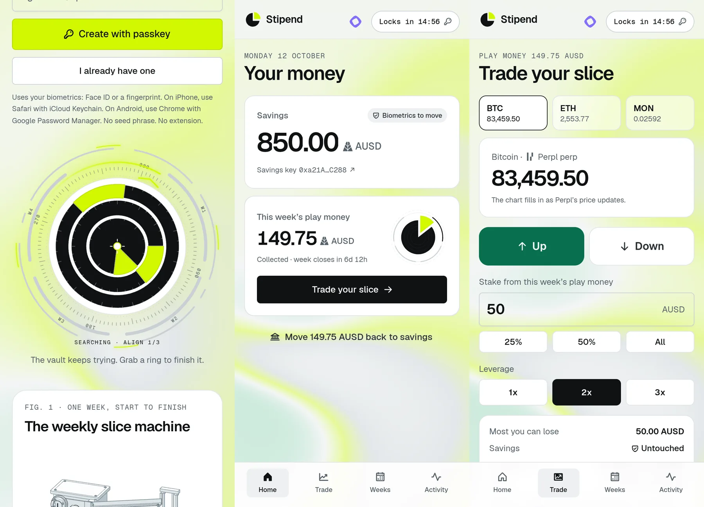
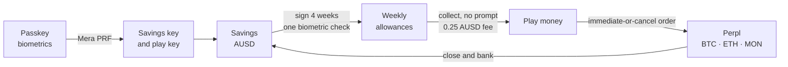
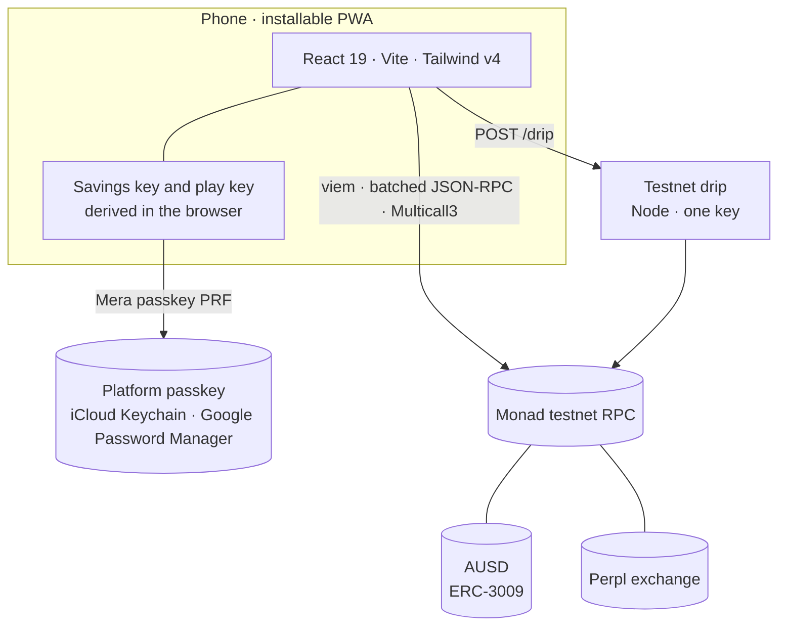

<div align="center">

<picture>
  <source media="(prefers-color-scheme: dark)" srcset="docs/assets/brand/stipend-mark-inverse.svg">
  
</picture>

# Stipend

**Savings that stay put. A weekly slice to trade.**<br>
A passkey money app on Monad. Your dollars sit in AUSD, and each week a capped slice unlocks for trading perps on Perpl.

[Live app](https://stipend.timidan.xyz) · [How it works](#how-it-works) · [Quickstart](#quickstart) · [Architecture](#architecture) · [Monad Metropolis](#monad-metropolis)


[](LICENSE)

</div>

<picture>
  <source media="(prefers-color-scheme: dark)" srcset="docs/assets/hero-dark.webp">
  
</picture>

Stipend splits one passkey into two keys. The **savings key** holds your AUSD and asks for biometrics every time money moves. The **play key** trades without prompts, but it can only spend what the savings key allowed this week. That limit isn't app code. It's four signed AUSD authorizations that the token itself enforces: each names an exact amount, opens on a Monday, closes a week later, and works once.

> [!IMPORTANT]
> Stipend runs on Monad testnet with test funds only. A small drip gives each new account 1,000 test AUSD and 0.2 test MON for gas, once a day. There is no mainnet mode.

## Highlights

- **One passkey, two keys.** Mera turns your passkey's PRF output into a savings key and a play key, on your device. Nothing is stored. Sign in on any device and both come back.
- **A cap the money enforces.** In one biometric check, your savings key signs four weekly `ReceiveWithAuthorization` permits. AUSD refuses anything above the amount, before the week opens, or twice.
- **Trade the slice on Perpl.** BTC, ETH or MON perps at 1x to 3x, as immediate-or-cancel orders. Before you confirm, Stipend shows the most you can lose and where Perpl would liquidate you.
- **Winnings go back.** Close a position and bank it: free AUSD moves from Perpl back to savings.
- **Built for phones.** An installable PWA with an offline shell, a WebGPU shader background that falls back to moving CSS, and a vault dial that keeps trying to line up your slice.
- **Every step on-chain.** The activity log links each transaction to the MonadVision explorer.

## Built with

<table>
  <tr>
    <td align="center" width="170">
      
      <br><sub><b>Monad</b> · testnet chain</sub>
    </td>
    <td align="center" width="170">
      <picture>
        <source media="(prefers-color-scheme: dark)" srcset="docs/assets/partners/agora-white.svg">
        
      </picture>
      <br><sub><b>AUSD by Agora</b> · savings and the weekly cap</sub>
    </td>
    <td align="center" width="170">
      <picture>
        <source media="(prefers-color-scheme: dark)" srcset="docs/assets/partners/mera-white.svg">
        
      </picture>
      <br><sub><b>Mera</b> · passkey keys</sub>
    </td>
    <td align="center" width="170">
      <picture>
        <source media="(prefers-color-scheme: dark)" srcset="docs/assets/partners/perpl-white.svg">
        
      </picture>
      <br><sub><b>Perpl</b> · perps</sub>
    </td>
  </tr>
</table>

Also used: **MonadVision** (BlockVision's explorer) for every receipt link, and **Chainlink Data Streams**, which feed Perpl's mark and oracle prices. The app is React 19, Vite, Tailwind CSS v4 and viem, with motion, Radix UI, SmoothUI components, Phosphor icons and the shaders library.

## How it works



1. **Create a passkey.** One biometric prompt. Mera returns a PRF secret, and Stipend derives the two keys from it with SHA-256, one label per key.
2. **Get test funds.** The drip sends test MON to the play key first, then 1,000 test AUSD to savings.
3. **Sign four weeks.** The savings key signs four EIP-712 permits for the play key. They stay in this browser.
4. **Collect this week.** The play key submits this week's permit. AUSD moves the slice from savings to the play key, and 0.25 AUSD goes to Stipend's treasury.
5. **Trade.** The first trade opens a Perpl account and deposits the slice. Orders are immediate-or-cancel: what can't fill at once is cancelled, so a miss spends nothing.
6. **Close and bank.** Closing settles on Perpl. Banking withdraws free AUSD and sends it back to savings.

### The weekly cap

Each week is one AUSD `ReceiveWithAuthorization` (ERC-3009), signed by the savings key:

| Field | Value |
|---|---|
| `from` → `to` | Savings key → play key |
| `value` | The weekly amount (at least 120 AUSD on testnet, because a Perpl account needs 100) |
| `validAfter` | Monday 00:00 UTC of that week |
| `validBefore` | Seven days later |
| `nonce` | `keccak256("stipend", savings key, week start)` |

Only the play key can submit it (`receiveWithAuthorization` checks the caller). A used, early or expired permit reverts on-chain. To cancel a future week, the savings key signs `CancelAuthorization` for its nonce.

### Who pays

You do, 0.25 AUSD per weekly collection. On testnet that fee goes to the drip wallet and refills its stock.

## Architecture



- **Keys stay on the device.** The savings key is derived for one action and dropped right after. The play key lives in memory. It locks after 15 idle minutes, or after 2 minutes in the background.
- **No custody backend.** The only server is the testnet drip. It holds test funds, gives each address one drip a day, and sends its MON gift before anything else, because of Monad's [reserve balance](https://docs.monad.xyz/developer-essentials/reserve-balance) rule.
- **Allowances live in this browser.** Clear it and your keys still come back from the passkey. Signing the weeks again takes one biometric check.
- **Gas.** Monad charges the gas limit. A full cycle (collect, open, close, bank) costs about 0.12 test MON.
- **Gentle on the public RPC.** Reads are batched through Multicall3, polling pauses during transactions, and rate-limited calls retry with backoff.

## Quickstart

**Requirements:** Node.js 22 and a browser with passkey PRF support (Safari with iCloud Keychain, or Chrome with Google Password Manager).

```sh
npm ci
npm run dev        # then open http://localhost:5173
```

Open it at `localhost`, not `127.0.0.1`: passkeys only work on a domain name, and anywhere except `localhost` they also need HTTPS.

<details>
<summary><b>Optional: run the test-funds drip</b></summary>

```sh
cp deploy/drip.env.example deploy/drip.env    # add a Monad testnet key you control
set -a; . deploy/drip.env; set +a
ALLOW_ORIGIN=http://localhost:5173 node drip/server.mjs    # port 8797; Vite proxies /drip to it
```

Fund the key with test MON from [faucet.monad.xyz](https://faucet.monad.xyz). The drip refills its AUSD stock from Agora's testnet faucet on its own.

</details>

## Configuration

| Variable | Used by | Default | Purpose |
|---|---|---|---|
| `VITE_RPC_URL` | App build | `https://testnet-rpc.monad.xyz` | Monad testnet RPC |
| `VITE_TREASURY` | App build | `0x…bEEF` (placeholder) | Receives the 0.25 AUSD fee |
| `VITE_DRIP_URL` | App build | `/drip` | Where "Get test AUSD" posts |
| `DRIP_PRIVATE_KEY` | Drip | none | Testnet key that funds new accounts |
| `ALLOW_ORIGIN` | Drip | none | The one app origin allowed to call it |
| `RPC_URL` | Drip | `https://testnet-rpc.monad.xyz` | Monad testnet RPC |
| `PORT` | Drip | `8797` | Listens on `127.0.0.1` only |

> [!CAUTION]
> Never commit `deploy/drip.env`. Git ignores it. Use a testnet-only key.

## Contracts

All on Monad testnet (chain `10143`):

| Contract | Address |
|---|---|
| AUSD | [`0xa9012a055bd4e0eDfF8Ce09f960291C09D5322dC`](https://testnet.monadvision.com/address/0xa9012a055bd4e0eDfF8Ce09f960291C09D5322dC) |
| AUSD testnet faucet | [`0xd236c18D274E54FAccC3dd9DDA4b27965a73ee6C`](https://testnet.monadvision.com/address/0xd236c18D274E54FAccC3dd9DDA4b27965a73ee6C) |
| Perpl exchange | [`0x1964C32f0bE608E7D29302AFF5E61268E72080cc`](https://testnet.monadvision.com/address/0x1964C32f0bE608E7D29302AFF5E61268E72080cc) |
| Multicall3 | [`0xcA11bde05977b3631167028862bE2a173976CA11`](https://testnet.monadvision.com/address/0xcA11bde05977b3631167028862bE2a173976CA11) |

Stipend deploys no contracts of its own.

## Scripts

| Command | |
|---|---|
| `npm run dev` | Vite dev server on port 5173 |
| `npm run build` | Type-check and production build to `dist/` |
| `npm run check` | Type-check |
| `npm run build:drip` | Bundle the drip into one file for the server (`deploy/drip/server.mjs`) |

## Project structure

```text
stipend/
├── src/
│   ├── screens/            Welcome, Home, Trade, Weeks and Activity
│   ├── components/         Shell, sheets, brand marks, vault dial, backdrop, the Fig. 1 machine
│   │   ├── iso/            The Anatomy kit (MIT) and the Fig. 1 machine's geometry and model
│   │   ├── smoothui/       Vendored SmoothUI components (Phosphor icons)
│   │   └── ui/             Button, input and tooltip primitives
│   └── lib/
│       ├── stipend.ts      Chain calls: keys, allowances, AUSD, Perpl
│       ├── session.ts      Passkey sign-in and the per-action savings key
│       ├── app.ts          App state, polling, actions and the lock timer
│       └── app-data.ts     Saved allowances and plain-English errors
├── drip/server.mjs         Testnet drip (Node, no framework)
├── scripts/smoke.ts        Core loop on an anvil fork
├── public/                 Manifest, service worker, icons and share image
├── deploy/                 Docker Compose, Caddy and the edge proxy block
└── docs/assets/            Images used in this README
```

## Deploy

[`deploy/`](deploy) runs Stipend on one host with Docker Compose. The `web` container (Caddy) serves `dist/` and passes `/drip` to the `drip` container (Node), which shares its network, so the drip is never exposed.

```sh
npm ci && npm run build && npm run build:drip
cp deploy/drip.env.example deploy/drip.env    # a testnet key you control
docker compose -f deploy/compose.yaml up -d
```

Public traffic reaches the `web` container through an existing reverse proxy on the `public_proxy` network; [`deploy/edge.caddy`](deploy/edge.caddy) is its site block. Build with `VITE_TREASURY` set to the drip's address so fees refill it.

## Testing

```sh
npm run check && npm run build
```

The core loop also runs against an anvil fork of Monad testnet:

```sh
anvil --fork-url https://testnet-rpc.monad.xyz --port 8551 --chain-id 10143 --disable-code-size-limit
VITE_RPC_URL=http://127.0.0.1:8551 node --experimental-strip-types scripts/smoke.ts
```

A fork doesn't model Monad's reserve balance or the public RPC's rate limits, so check one full journey on live testnet before a release.

## Design

- **Type.** Geist for text and Geist Mono for data labels, addresses and hashes, both from Google Fonts. Numbers use tabular figures, and balances and live prices roll digit by digit when they change.
- **Lime highlighter.** A lime stroke underlines "A weekly slice" in the Welcome headline. The same lime marks the main action buttons, this week's open allowance and the slice itself.
- **Icons.** Phosphor only. They nudge on press, focus or hover: arrows slide and the key wiggles.
- **SmoothUI components.** Unlock Face ID for the biometric unlock on Home, Border Beam around this week's card while its allowance is open, and Button Copy for the key addresses on Activity.
- **Moving backdrop.** With WebGPU, a mesh-gradient shader with film grain moves behind every screen. Its code loads only once the browser offers a WebGPU adapter. Without one, two soft lime and green CSS gradients drift instead.
- **Vault dial.** On Welcome, the three rings of the Stipend coin keep trying to line up this week's slice on their own and never quite manage. Drag a ring, or use the arrow keys, to finish it, and the slice slides out.
- **Fig. 1, the weekly slice machine.** An animated isometric drawing of one week in a 24-second loop: unlock, sign four weeks, collect, trade on Perpl, close and bank. Hover, touch or focus holds it, and the arrow keys step through its phases. On phones its parts legend is a row of tabs with one panel that follows the tour. Wider screens list all seven parts and mark the one in play.
- **Light and dark.** Both themes follow the system setting, applied before the first paint so the page doesn't flash.
- **Reduced motion.** When the system asks for less motion, the backdrop, the vault dial and the machine hold still, and other animations skip their movement.

## Monad Metropolis

Stipend is entered in **Onchain Finance & Trading**, Agora's **Best Mobile Trading App on Monad**, and Monad Foundation's **Best Mera-Powered UX on Monad**.

| The brief asks for | Where Stipend does it |
|---|---|
| Authenticate users via Mera | One passkey ceremony; both keys come from its PRF output |
| Hold and display a stablecoin balance in AUSD | Home shows savings and this week's play money in AUSD |
| Execute trades through Perpl | Immediate-or-cancel orders on BTC, ETH and MON perps, with close and withdraw |
| Prompt-free signing through scoped sessions | The play key trades with no prompt; the savings key re-prompts every time |
| Session expiry | The play key locks after 15 idle minutes, or 2 minutes in the background |
| The stateless test | Clear storage or switch devices: sign in with the same passkey and both keys come back |
| Real transactions | Every step is a Monad testnet transaction, linked from the activity log |

## License

[MIT](LICENSE) © 2026 Timidan. The Anatomy kit in [`src/components/iso/`](src/components/iso) keeps its own [MIT license](src/components/iso/LICENSE). Partner names and logos belong to their owners.
